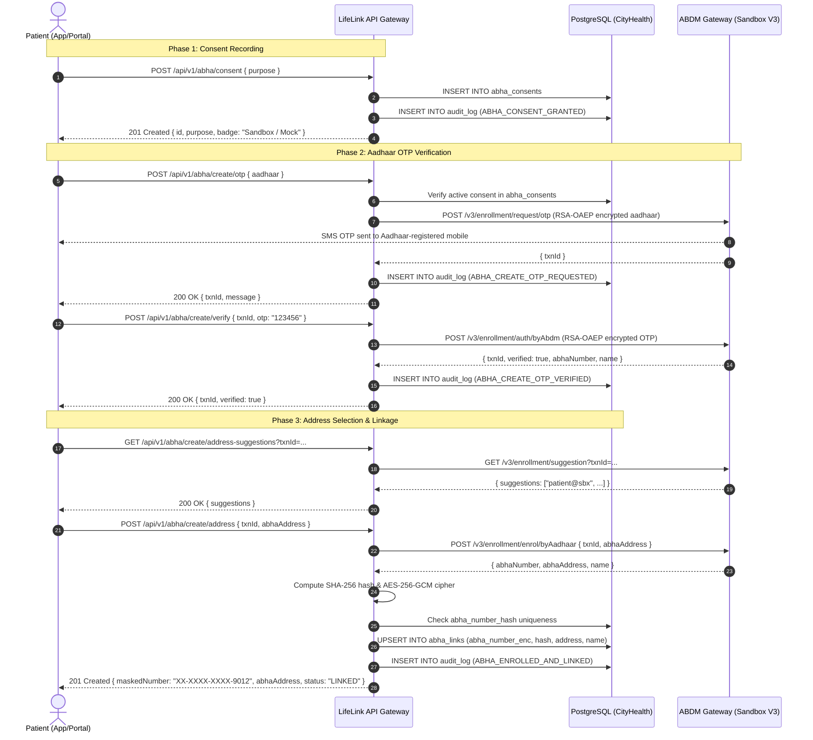
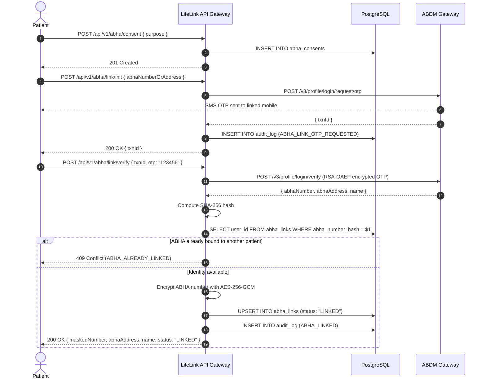

# Ayushman Bharat Digital Mission (ABDM) Milestone 1 Integration

LifeLink CityHealth integrates with the National Health Authority's (NHA) Ayushman Bharat Digital Mission (ABDM) Milestone 1 protocols, facilitating secure ABHA (Ayushman Bharat Health Account) creation, linkage, verification, and unlinking for patients.

---

## 1. High-Level Architecture & Governance

LifeLink acts as an ABDM Health Information Provider (HIP) / Health Information User (HIU) client. 

### Key Governance Invariants:
1. **Google OAuth Sole Identity Provider**: System authentication is strictly via Google OAuth 2.0 (Gmail). ABHA is an external federated identity linked to an existing authenticated `PATIENT` record.
2. **Mandatory Patient Consent**: No ABDM API call (`/create/*` or `/link/*`) can be initiated without an active, non-revoked consent record in `abha_consents`. Consent can be revoked at any time via `DELETE /api/v1/abha/consent`.
3. **Strict Zero-Knowledge Ephemeral PII**: Aadhaar numbers and one-time passwords (OTPs) exist exclusively in runtime memory during the execution of the HTTP handler. They are strictly prohibited from being persisted to disk, relational databases, cache stores, server log files, or error trace payloads.
4. **At-Rest AES-256-GCM Encryption**: Stored ABHA numbers are symmetrically encrypted using AES-256-GCM with a 32-byte cryptographic key (`ABHA_ENC_KEY`). A 12-byte IV and 16-byte authentication tag are stored with the ciphertext.
5. **Distributed Uniqueness Constraint**: An irreversible SHA-256 hash (`abha_number_hash`) guarantees a strict 1-to-1 relationship between an ABHA identity and a registered patient account.
6. **Masked Public Representations**: APIs and staff interfaces expose only standard ABDM masked format: `XX-XXXX-XXXX-${last4}`.
7. **Rate Limiting & Degraded Mode Resilience**: All ABHA endpoints are throttled to 5 requests/minute per client. If the ABDM National Gateway suffers network partitioning or downtime, calls return `503 ABDM_UNAVAILABLE` while LifeLink's core emergency bed discovery and equipment services continue operating uninterrupted.

---

## 2. Sequence Diagrams

### 2.1 ABHA Enrollment & Creation Workflow

---

### 2.2 Existing ABHA Linkage & Verification Workflow

---

## 3. Cryptographic & Privacy Model

| Field / Secret | Security Policy | Storage Mechanism | Log Redaction Rule |
| :--- | :--- | :--- | :--- |
| **Aadhaar Number** | Ephemeral only. Zero-disk persistence. | Memory only (destroyed after request). | Pino `*.aadhaar`, `req.body.aadhaar` -> `[REDACTED]` |
| **One-Time Password (OTP)** | Ephemeral only. Zero-disk persistence. | Memory only (destroyed after request). | Pino `*.otp`, `req.body.otp` -> `[REDACTED]` |
| **ABHA Number (Raw)** | Confidential medical identifier. | AES-256-GCM encrypted in `BYTEA` column `abha_number_enc`. | Pino `*.abhaNumber` -> `[REDACTED]` |
| **ABHA Number (Hash)** | Uniqueness enforcement (one-to-one). | SHA-256 normalized digest in `abha_number_hash` (`VARCHAR(64)` UNIQUE). | Safe for index lookups. |
| **ABHA Masked** | Public user identity representation. | Derived dynamically: `XX-XXXX-XXXX-${last4}`. | Safe for API response envelopes. |
| **ABHA Address** | Public routing address (e.g. `user@sbx`). | Stored plain in `abha_address` (`VARCHAR(128)`). | Safe for API response envelopes. |

---

## 4. Environment Variables Reference (ABDM Sandbox V3)

| Environment Variable | Required | Default / Example Value | Description |
| :--- | :---: | :--- | :--- |
| `ABDM_MODE` | Yes | `mock` (or `sandbox`, `production`) | Toggles client adapter between deterministic in-memory mock and live ABDM gateway. |
| `ABDM_CLIENT_ID` | Yes | `your-abdm-client-id` | Bridge client ID issued by NHA developer portal. |
| `ABDM_CLIENT_SECRET` | Yes | `your-abdm-client-secret` | Bridge client secret issued by NHA developer portal. |
| `ABDM_SESSION_URL` | Yes | `https://dev.abdm.gov.in/api/hiecm/gateway/v0.5/sessions` | Gateway endpoint to generate temporary OAuth 2.0 bearer access token. |
| `ABDM_CERT_URL` | Yes | `https://dev.abdm.gov.in/api/v1/auth/cert` | Gateway public X.509 certificate endpoint for RSA-OAEP payload encryption. |
| `ABDM_ABHA_BASE_URL` | Yes | `https://healthidsbx.abdm.gov.in/api` | Base URL for ABDM ABHA V3 enrollment and profile APIs. |
| `ABHA_ENC_KEY` | Yes | `MDEyMzQ1Njc4OTAxMjM0NTY3ODkwMTIzNDU2Nzg5MDE=` | 32-byte Base64-encoded key for AES-256-GCM symmetric encryption. |

---

## 5. ABDM Milestone 1 Sandbox Exit Checklist

To obtain production approval from the National Health Authority (NHA), all items in this checklist must be satisfied and verified:

### 1. Functional Milestone 1 Scope
- [x] **Aadhaar-based ABHA Generation**: Verification of 12-digit Aadhaar via OTP and demographic profile creation.
- [x] **ABHA Address (PHR Address) Suggestion & Selection**: Real-time suggestion retrieval and custom address claiming (`@abdm` / `@sbx`).
- [x] **Existing ABHA Linking**: Initiation and OTP verification of pre-existing ABHA credentials.
- [x] **ABHA Profile Retrieval**: Secure status inspection returning standard masked identifiers.
- [x] **Patient-Initiated Unlinking**: Total purging of linked records with immutable audit tracking.
- [x] **Consent Lifecycle**: Granting, inspection, and immediate revocation of data-exchange permissions.

### 2. Privacy & Security Invariants
- [x] **Zero Aadhaar / OTP Storage**: Verified through database inspection and comprehensive integration test assertions (`expect(JSON.stringify(auditLog)).not.toContain(rawAadhaar)`).
- [x] **Pino Logger Redaction**: Automated sanitization of request bodies, headers, and error contexts.
- [x] **AES-256-GCM Encryption**: Verified encrypted storage of ABHA numbers in binary `BYTEA` format with authenticated tags.
- [x] **SHA-256 Uniqueness Enforcement**: Verified prevention of duplicate cross-account linking (HTTP 409).
- [x] **Rate Limiting**: Coordinated token bucket / sliding window limiter capping client traffic at 5 req/min.

### 3. Operational & Network Reliability
- [x] **Gateway Token Caching**: Redis caching of gateway bearer tokens with TTL renewal.
- [x] **Certificate Caching**: Redis caching of NHA public certificate (24-hour expiration).
- [x] **Circuit Breaker Protection**: Tripping after 3 consecutive failures to safeguard system resources.
- [x] **Degraded Mode Independence**: Full functionality of emergency bed discovery and telemetry when ABDM upstream is partitioned.
- [x] **Non-Production Visual Indicator**: Mandatory `"Sandbox / Mock"` badge surfaced across all API responses during sandbox phase.

